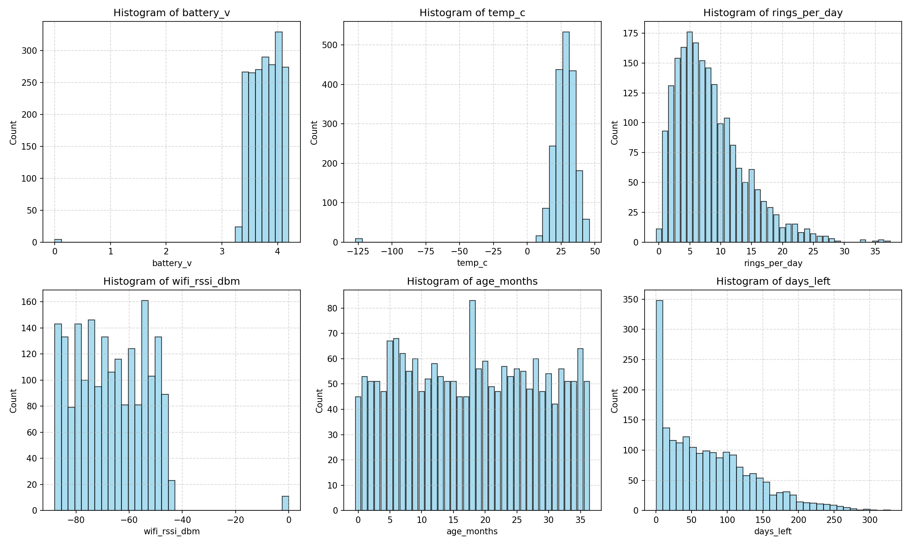
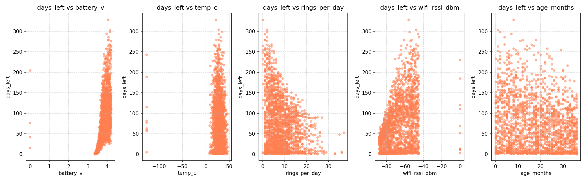
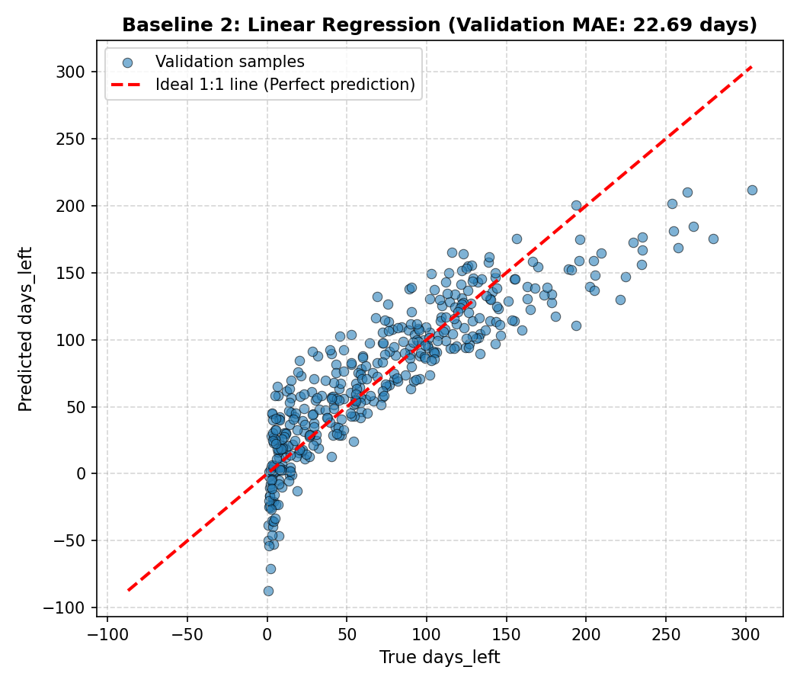

# Mission 1 Engineering Report: Meet the Data and Set the Bar
**Project:** AI255TBD Edge AI · Doorbell Battery Remaining Days Prediction  
**Team Number:** 16  
**Dataset:** `data/team_16_train.csv` (2,000 raw readings)  
**Date:** November 20, 2026  

---

## 1. Overview & Objectives

The primary goal of Mission 1 is to understand the sensor data characteristics, identify and purge hardware glitches, establish performance baselines, and evaluate how an unnormalized neural network compares against basic statistical baselines.

Every mission follows the principle: **Write a prediction with a number → Measure → Explain the gap.**

```
Raw Data (2,000 rows)
       │
       ▼
Glitch Filtering (Drop 24 hardware error rows)
       │
       ▼
Clean Data (1,976 rows: 1,581 Train / 395 Val)
       ├── Baseline 1 (Mean Guess):        51.90 days MAE
       ├── Baseline 2 (Linear Regression): 22.69 days MAE
       └── Starter Network (Unnormalized):  9.59 days MAE
```

---

## 2. Prediction of the Error: Always Guessing the Average

Before training any model, we predict the error of a naive strategy: always predicting the average battery lifetime ($\bar{y}$).

* **Initial Hypothesis / Prediction:** If battery lifespans span roughly 0 to 300 days with an average around ~70–75 days, the standard deviation is around ~60 days. The expected mean absolute deviation of a right-skewed distribution is typically $\approx 0.8 \times \sigma \approx 50\text{ days}$.
* **Empirical Measurement:**
  - Training Set Mean: **$74.60\text{ days}$**
  - Validation MAE: **$51.90\text{ days}$**
* **Conclusion:** Always predicting the mean is unusable in production—being off by 52 days on a doorbell battery defeats the purpose of the device.

---

## 3. Data Distribution & Relationships

### 3.1 Feature Histograms
We examined the distributions of all 5 sensor features and the target variable. For discrete variables (`age_months` and `rings_per_day`), integer-aligned binning was used to prevent artificial grouping artifacts.



### 3.2 Target (`days_left`) vs. Input Features
To evaluate linearity, we plotted `days_left` against each individual feature:



### 3.3 Which Relationships Are Not Straight Lines?

| Feature | Linearity | Underlying Physical Behavior |
|---|---|---|
| **`battery_v`** | **Strongly Non-Linear (S-Curve)** | Chemical discharge curve of Lithium-ion cells is sigmoidal: flat plateau between 4.0V–4.2V, steep nominal drop between 3.6V–3.8V, and a rapid vertical cliff below 3.5V. |
| **`rings_per_day`** | **Strongly Non-Linear (Hyperbolic $\sim 1/x$)** | Battery lifespan is inversely proportional to daily energy expenditure ($\text{Days} \propto \frac{1}{\text{Rings}}$). A jump from 2 to 4 rings halves lifespan, whereas 20 to 22 rings causes negligible marginal change. |
| **`wifi_rssi_dbm`** | **Non-Linear (Power Cliff)** | RSSI is measured on a logarithmic scale. When signal drops below -80 dBm, packet loss triggers high-power RF retransmissions, creating an abrupt battery consumption cliff. |
| **`temp_c`** | **Weakly Non-Linear (Inverted-U)** | Extremes of cold (< 15°C) reduce ion mobility, while high heat (> 35°C) increases self-discharge rates. Optimal performance is centered around room temperature (~20°C–25°C). |
| **`age_months`** | **Approximately Linear** | Cell degradation due to solid-electrolyte interphase (SEI) growth produces a steady, near-constant capacity loss ($\approx -1.07\text{ days/month}$). |

---

## 4. Hardware Glitch Rules & Data Cleaning

Sensor readings outside physically possible operating regimes were identified in the raw dataset.

```python
# Glitch rules implemented in train.py:
bad = (
    (df["battery_v"] <= 0)
    | (df["temp_c"] < -20)
    | (df["wifi_rssi_dbm"] >= 0)
)
```

### Glitch Diagnostics & Safety Justification

1. **`battery_v <= 0` (4 rows dropped):**
   - *Physical reality:* Lithium-ion single cells shut down at ~3.0V. An active microcontroller transmitting telemetry at 0.0V indicates a disconnected ADC pin or power rail sensor failure.
2. **`temp_c < -20` (9 rows dropped):**
   - *Physical reality:* All 9 dropped rows recorded exact values of **`-127.0 °C`**. In digital 1-Wire sensors (such as Dallas/Maxim DS18B20), `-127 °C` (power-on reset / 0x85 error code) is emitted when the sensor bus fails to respond. Outdoor ambient temperatures never reach -127°C.
3. **`wifi_rssi_dbm >= 0` (11 rows dropped):**
   - *Physical reality:* All 11 dropped rows recorded exact values of **`0.0 dBm`**. Wi-Fi received signal power is strictly negative in dBm (typically -30 to -88 dBm). An RSSI of 0 dBm signifies a network stack timeout or disassociated driver state.

> [!NOTE]
> **Total Glitches Dropped:** Exactly **24 rows** (1.2% of dataset).  
> **Remaining Clean Data:** **1,976 rows** (Train: 1,581 | Validation: 395).

---

## 5. Performance Baselines

All metrics are evaluated on the 20% validation split ($N_{\text{val}} = 395$) using fixed seed (`seed=0`).

### 5.1 Baseline 1: Always Guessing the Mean
* **Model:** $\hat{y} = \bar{y}_{\text{train}} = 74.60\text{ days}$
* **Validation MAE:** **`51.90 days`**

### 5.2 Baseline 2: Linear Regression (`np.linalg.lstsq`)
* **Model:** $\hat{y} = X w + b$ fit via ordinary least squares on $[X, \mathbf{1}]$
* **Validation MAE:** **`22.69 days`**

```python
# Baseline 2 Implementation in train.py:
X_train_linear = np.column_stack((X, np.ones(len(X))))
X_val_linear = np.column_stack((Xv, np.ones(len(Xv))))
coefficients, _, _, _ = np.linalg.lstsq(X_train_linear, y, rcond=None)
linear_predictions = X_val_linear @ coefficients
print(f"baseline (linear regression): {mae(linear_predictions, yv):.2f} days")
```

#### Fitted Coefficients ($w$):
* $w_{\text{battery\_v}} = \mathbf{+181.96}$
* $w_{\text{temp\_c}} = \mathbf{-0.89}$
* $w_{\text{rings\_per\_day}} = \mathbf{-2.86}$
* $w_{\text{wifi\_rssi\_dbm}} = \mathbf{+1.90}$
* $w_{\text{age\_months}} = \mathbf{-1.07}$
* $\text{Bias } (b) = \mathbf{-419.72}$

---

## 6. Where Is Baseline 2 Most Wrong?

Plotting predicted vs. true values exposes the structural limitations of a linear model:



```
        Error Distribution Across Target Ranges:
        ┌───────────────────┬────────────────────────┐
        │ True Days Range   │ Mean Absolute Error    │
        ├───────────────────┼────────────────────────┤
        │ 0 to 15 days      │ 22.70 days (overshoot) │
        │ 15 to 50 days     │ 20.55 days             │
        │ 50 to 100 days    │ 16.65 days             │
        │ 100 to 200 days   │ 21.62 days             │
        │ > 200 days        │ 69.81 days (severe)    │
        └───────────────────┴────────────────────────┘
```

### Analysis of Primary Failure Modes:
1. **Severe Underprediction at High Battery Lifetimes (> 200 days):**
   - When a doorbell is new, has low activity, and strong Wi-Fi, actual battery lifetime reaches 250–320 days.
   - The linear model caps out around 170–210 days, suffering errors exceeding **90 to 104 days**.
2. **Nonsensical Negative Predictions near Zero (< 15 days):**
   - Near depletion, the steep drop in battery voltage causes linear regression to overshoot into negative values (e.g., predicting **`-87.3 days`** for an actual battery with **`0.8 days`** remaining).

> [!IMPORTANT]
> A linear plane cannot curve. Because physical discharge and ring consumption are fundamentally non-linear, a non-linear neural network is strictly required.

---

## 7. Starter Neural Network Performance

We ran `train.py` with the default starter configuration ($5 \to 32 \to 32 \to 1$, 1500 epochs, unnormalized inputs):

* **Starter Network Validation MAE:** **`9.59 days`**
* **Comparison:**
  - Baseline 1 (Mean): $51.90\text{ days}$
  - Baseline 2 (Linear): $22.69\text{ days}$
  - Starter Neural Net: **$9.59\text{ days}$** (a **57.7% error reduction** over Linear Regression)

Even without feature normalization, the ReLU activations allow the network to approximate the non-linear battery and ring curves significantly better than linear regression.

---

## 8. Summary of Mission 1 Deliverables

| Requirement | Status | Result / Value |
|---|:---:|---|
| Predict Mean Error | Done | Predicted ~50 days, measured **51.90 days** |
| Plot Histograms & Scatters | Done | Saved in `graphs/updated/` and `graphs/previous/` |
| Identify Non-linearities | Done | Documented: `battery_v` (S-curve), `rings_per_day` ($1/x$), `wifi_rssi_dbm` |
| Glitch Rules in `train.py` | Done | Dropped 24 rows (`battery_v <= 0`, `temp_c < -20`, `wifi >= 0`) |
| Baseline 1 MAE | Done | **`51.90 days`** |
| Baseline 2 MAE (`lstsq`) | Done | **`22.69 days`** |
| Error Analysis & Plot | Done | Linear model fails at extremes (>200d underprediction, <15d negative days) |
| Starter Network MAE | Done | **`9.59 days`** |

All Mission 1 tasks are complete, pushed, and validated. The repository is primed for **Mission 2: Feature Normalization & Model Architecture Optimization**.
